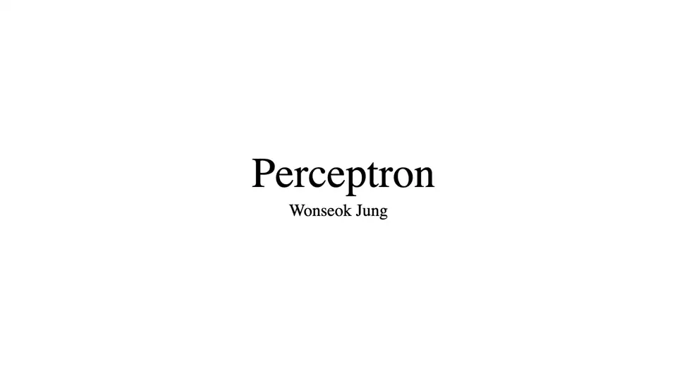
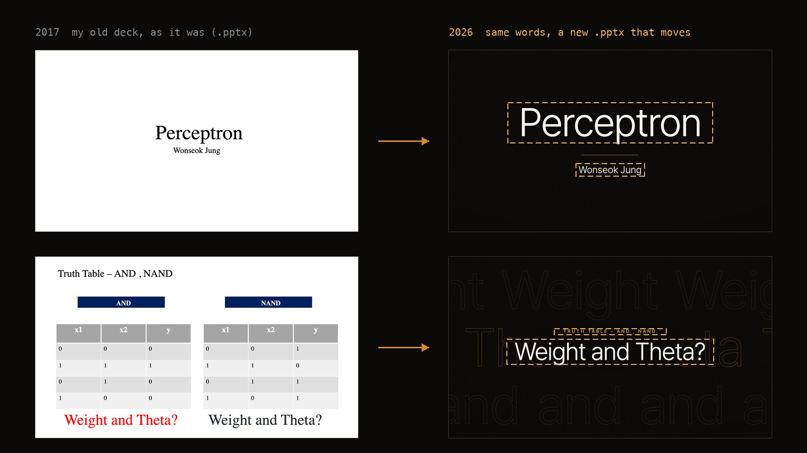
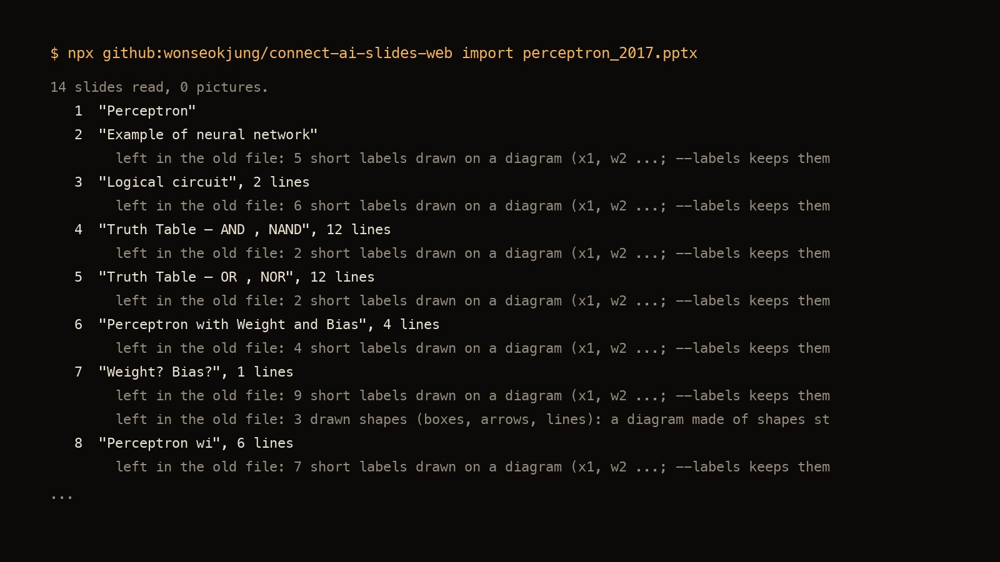
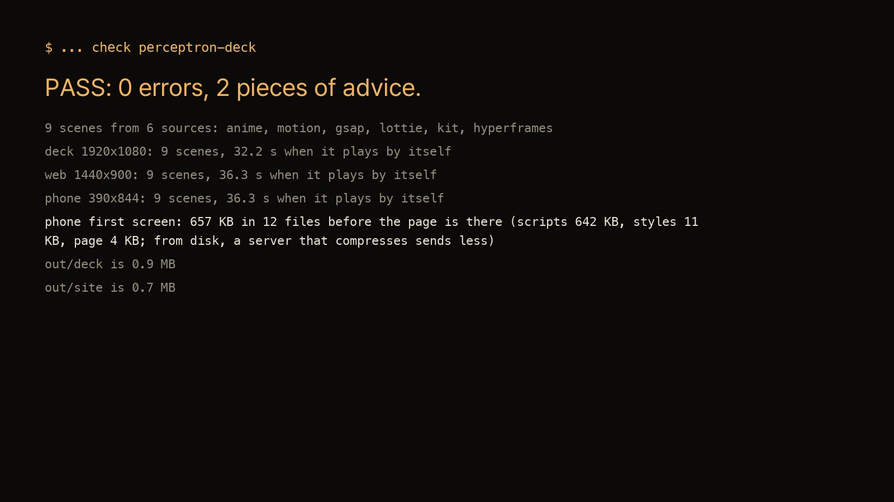
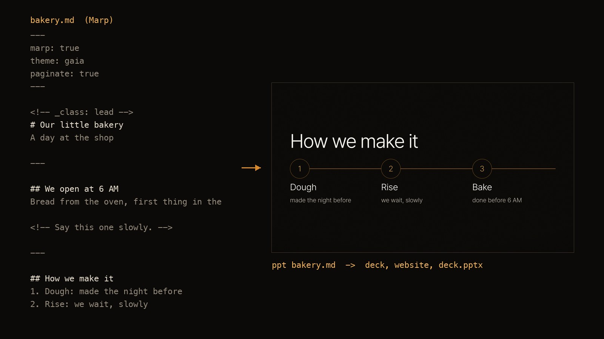

<p align="center"></p>

<p align="center">
  <b>CONNECT AI LAB</b> · 모두를 위한 AI 교육 · AI education for everyone<br>
  <a href="docs/textbook/index.html"><b>4강 교재</b></a> · <a href="https://www.youtube.com/@CONNECT-AI-LAB">YouTube: CONNECT AI LAB</a> · <a href="https://www.aicitybuilders.com/vibecoding">강의: 비주얼 바이브코딩</a> · <a href="README.md">English</a>
</p>

# connect-ai-slides-web

**1인 사업가, 유튜버 여러분들을 위한 AI 발표자료 직원이에요. 할 말 몇 줄만 주면 움직이는 발표자료랑 진짜 파워포인트 파일이 같이 나와요. 예전에 만들어 둔 PPT를 넣어도 돼요.**

[](docs/showcase/v04/hero.mp4)

```bash
npx github:wonseokjung/connect-ai-slides-web install-skill
```

설치는 이렇게 해요. 에이전트(Claude Code, Codex, Antigravity, Cursor) 채팅창에 위 한 줄을 붙여 넣고 설치해 달라고 하세요. 다 되면 새 채팅을 여시고 이렇게 말해 보세요. "내 가게 소개 발표자료 만들어 줘." 예전 PPT가 있으시면 "이 PPT 움직이게 다시 만들어 줘" 하시면 돼요.

직접 깔아야 하는 건 [Node.js](https://nodejs.org) 18.18 이상, 크롬, 코딩 에이전트예요. ffmpeg까지 있으면 움직임이 파워포인트 안에 영상 클립으로 들어가요. 에이전트는 쓰시던 걸 그대로 쓰시면 되고, 이 도구에 넣는 유료 API 키는 따로 없어요.

## 이런 걸 해요

전부 제가 실제로 돌려서 나온 화면이에요.

<table>
<tr>
<td width="50%" valign="top"><br><b>옛 PPT 다시 만들기</b> · v0.4<br><sub>예전 .pptx를 주면 글자, 사진, 발표자 노트를 꺼내서 한 장에 하나씩만 말하는 발표자료로 다시 만들어요. 오른쪽 금색 점선은 새 파일 안에 있는 글상자 자리예요.</sub></td>
<td width="50%" valign="top"><br><b>글자 하나하나 고치는 PPT</b><br><sub>글자는 전부 진짜 글상자예요. 움직임은 슬라이드마다 영상 클립으로 들어가고, 넘기면 저절로 시작하게 넣어 둬요. 글자는 브라우저 발표에서 나오는 그 순간에 나타나요.</sub></td>
</tr>
<tr>
<td width="50%" valign="top"><br><b>뭘 가져왔고 뭘 두고 왔는지</b> · v0.4<br><sub>장마다 다 알려 줘요. 도형으로 그린 그림, 차트, 수식, 숨긴 장은 옛 파일에 그대로 있다고 말해 주거든요.</sub></td>
<td width="50%" valign="top"><br><b>같은 이야기로 웹사이트도</b><br><sub>발표자료랑 한 장짜리 웹사이트가 같은 원고에서 같이 나와요. 폰에서는 스크롤하면 움직여요.</sub></td>
</tr>
<tr>
<td width="50%" valign="top"><br><b>스스로 검사해요</b><br><sub>진짜 화면 크기로 열어서 글자 크기, 한 장에 들어간 말, 색 대비, 잘린 글자를 재요. 움직임을 꺼 둔 분한테도 글자가 다 보이는지, 폰에서 처음에 얼마나 받아야 하는지도 봐요.</sub></td>
<td width="50%" valign="top"><br><b>Marp, Slidev 원고도 그대로</b> · v0.4<br><sub>다른 도구로 써 둔 마크다운 발표자료가 있으시면 그대로 넣으세요. 주석은 발표자 노트로 들어가요.</sub></td>
</tr>
</table>

## 제 2017년 PPT로 해 봤어요

제가 2017년에 만들어서 깃허브에 올려 둔 퍼셉트론 PPT예요. 14장을 넣었더니 제목, 문장, 표 내용은 다 들어왔어요. 도형으로 그린 신경망 그림이랑 그 위의 작은 글자(x1, w2 같은 거)는 옛 파일에 두고 왔다고 장마다 알려 줬고요. 그다음에 에이전트가 제 말만 써서 9장으로 줄였어요. 제가 안 한 말은 하나도 안 들어갔어요.

## 파워포인트 안에는

| | |
|---|---|
| 글자 | 진짜 글상자예요. 눌러서 바로 고치시면 돼요 |
| 움직임 | 슬라이드마다 영상 클립으로 들어가고, 넘기면 저절로 시작하게 넣어 둬요 (`--click` 이면 눌러서 시작). ffmpeg가 없으면 클립 대신 멈춘 그림이 깔려요 |
| 노트 | 발표자 노트가 슬라이드마다 들어가요 |
| Google Slides | `--google` 을 붙이면 영상 대신 멈춘 그림을 깐 파일이 하나 더 나와요 |

파일 안은 `inspect` 로 확인했고, 화면은 맥의 훑어보기(Quick Look)로 열어서 봤어요. 파워포인트 앱에서 직접 틀어 보는 건 아직이라, 발표하실 컴퓨터에서 한 번 열어 보세요. [한국어 deck.pptx](docs/demo/ko/deck.pptx) · [영어 deck.pptx](docs/demo/en/deck.pptx). 움직임 블록 67개는 [카탈로그 페이지](docs/index.html)에서 볼 수 있어요.

<!-- team:start -->
## CONNECT AI LAB의 AI 직원들

AI 직원을 하나씩 오픈소스로 만들고 있어요. 필요한 직원부터 데려가 쓰세요.

<table>
<tr><td width="34%" valign="top"><b>사업 해부 직원</b><br><a href="https://github.com/wonseokjung/reversebusiness"><code>reversebusiness</code></a></td><td valign="top">사업 웹사이트 주소 하나 주면 그 사업이 어떻게 돈 버는지 읽어 줘요.</td></tr>
<tr><td width="34%" valign="top"><b>영상 편집 직원</b><br><a href="https://github.com/wonseokjung/connect-ai-video-motion"><code>connect-ai-video-motion</code></a></td><td valign="top">내 영상을 주면 몸을 피해서 빈자리에 모션그래픽을 넣어 줘요.</td></tr>
<tr><td width="34%" valign="top"><b>모션그래픽 직원</b><br><a href="https://github.com/wonseokjung/connect-ai-motion"><code>connect-ai-motion</code></a></td><td valign="top">글 몇 줄 주면 모션그래픽 영상을 만들어 줘요. 찍은 영상은 없어도 돼요.</td></tr>
<tr><td width="34%" valign="top"><b>발표자료 직원</b> · <b>지금 보는 직원</b><br><a href="https://github.com/wonseokjung/connect-ai-slides-web"><code>connect-ai-slides-web</code></a></td><td valign="top">할 말 몇 줄이나 예전 PPT를 주면 움직이는 덱이랑 고칠 수 있는 파워포인트 파일을 만들어 줘요.</td></tr>
<tr><td width="34%" valign="top"><b>마케팅팀</b><br><a href="https://github.com/wonseokjung/connect-ai-marketer"><code>connect-ai-marketer</code></a></td><td valign="top">내 브라우저에서 24시간 댓글, 리스닝, 업로드를 맡아요.</td></tr>
<tr><td width="34%" valign="top"><b>글쓰기 직원</b><br><a href="https://github.com/wonseokjung/connect-ai-writer"><code>connect-ai-writer</code></a></td><td valign="top">영상 하나 주면 플랫폼마다 내 말투로 글을 쓰고 사진까지 같이 만들어 줘요.</td></tr>
<tr><td width="34%" valign="top"><b>XR 직원</b><br><a href="https://github.com/wonseokjung/connect-ai-xr"><code>connect-ai-xr</code></a></td><td valign="top">한 문장 주면 메타 퀘스트에서 열리는 XR 앱을 만들어 줘요. 컴퓨터랑 폰에서도 열려요.</td></tr>
</table>
<!-- team:end -->

---

에이전트 없이 먼저 보고 싶으시면 `npx github:wonseokjung/connect-ai-slides-web ppt` 해 보세요. 견본 원고 my-talk.md가 하나 생겨요. 그다음 `npx github:wonseokjung/connect-ai-slides-web ppt my-talk.md` 로 돌리면 파워포인트 파일까지 나와요. 명령이랑 옵션, 안 되는 것까지 [docs/guide.ko.md](docs/guide.ko.md)에 정리해 뒀어요.

라이선스는 MIT예요. 다만 GSAP는 GreenSock의 [무료 표준 라이선스](https://gsap.com/standard-license)고, Remotion은 개인, 직원 3명 이하 회사, 비영리는 무료지만 그보다 큰 회사는 따로 라이선스가 필요해요. 같이 쓰는 라이브러리는 [NOTICE.md](NOTICE.md)에 적어 뒀어요.

이런 도구를 내 AI 에이전트로 직접 만드는 법은 [비주얼 바이브코딩](https://www.aicitybuilders.com/vibecoding)에서 알려 드려요.

<table><tr>
<td width="140" valign="top"></td>
<td valign="top"><b>만든 사람: AI 멘토 제이</b> · CONNECT AI LAB<br>
앞으로도 AI 직원을 하나씩 오픈소스로 풀 거예요. 만드는 법은 유튜브랑 강의에서 다 보여 드려요.<br>
<a href="https://www.youtube.com/@CONNECT-AI-LAB">유튜브</a> · <a href="https://www.aicitybuilders.com/vibecoding">비주얼 바이브코딩</a> · <a href="https://github.com/wonseokjung">다른 오픈소스</a></td>
</tr></table>
