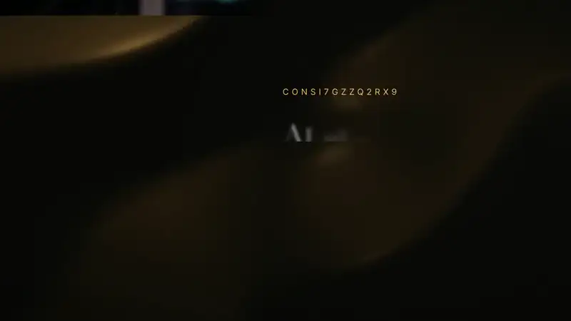
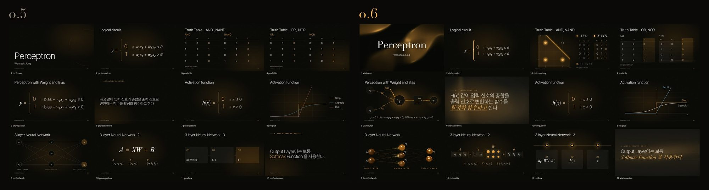
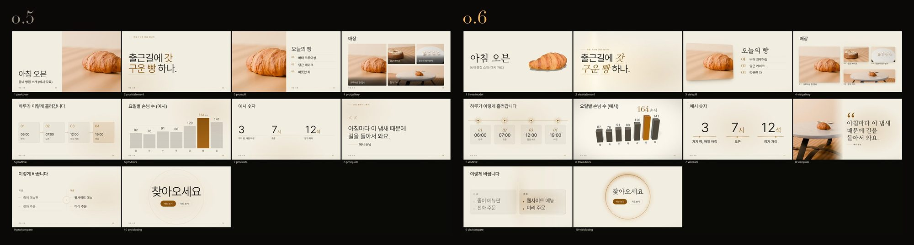
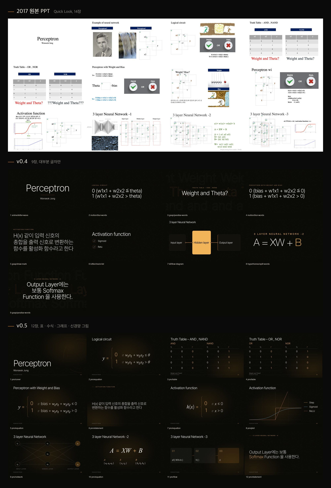
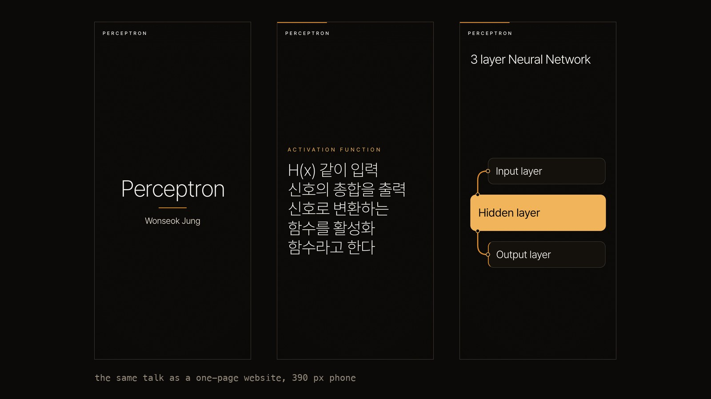

<p align="center"></p>

<p align="center">
  <b>CONNECT AI LAB</b> · 모두를 위한 AI 교육 · AI education for everyone<br>
  <a href="docs/textbook/index.html"><b>4강 교재</b></a> · <a href="https://www.youtube.com/@CONNECT-AI-LAB">YouTube: CONNECT AI LAB</a> · <a href="https://www.aicitybuilders.com/vibecoding">강의: 비주얼 바이브코딩</a> · <a href="README.md">English</a>
</p>

# connect-ai-slides-web

**1인 사업가, 유튜버 여러분들을 위한 AI 발표자료 직원이에요. 할 말 몇 줄만 주면 움직이는 발표자료랑 진짜 파워포인트 파일이 같이 나와요. 예전에 만들어 둔 PPT를 넣어도 돼요.**

[](docs/showcase/v04/hero.mp4)

```bash
npx github:wonseokjung/connect-ai-slides-web install-skill
```

설치는 이렇게 해요. 에이전트(Claude Code, Codex, Antigravity, Cursor) 채팅창에 위 한 줄을 붙여 넣고 설치해 달라고 하세요. 다 되면 새 채팅을 여시고 이렇게 말해 보세요. "내 가게 소개 발표자료 만들어 줘." 예전 PPT가 있으시면 "이 PPT 움직이게 다시 만들어 줘" 하시면 돼요.

직접 깔아야 하는 건 [Node.js](https://nodejs.org) 18.18 이상, 크롬, 코딩 에이전트예요. ffmpeg까지 있으면 움직임이 파워포인트 안에 영상 클립으로 들어가요. 에이전트는 쓰시던 걸 그대로 쓰시면 되고, 이 도구에 넣는 유료 API 키는 따로 없어요.

## 0.6: 이제 장마다 그림이랑 움직임이 먼저 나와요

0.5는 깔끔했는데 글자만 보였거든요. 비주얼 바이브코딩인데 그러면 안 되잖아요. 그래서 0.6에서는 마크다운 몇 줄만 써도 장마다 그림이나 움직임이 먼저 나오게 바꿨어요.

[](docs/showcase/v06/hero.mp4)

- 3D 모델이 표지에서 천천히 돌아요. `.glb` 파일 하나만 넣으시면 돼요.
- 숫자 표는 3D 막대그래프로 솟아요. 값은 막대가 크는 만큼 같이 올라가요.
- 배경의 금색 빛이 살아서 움직여요. 셰이더로 그린 거예요.
- 수식, 결정 경계, 신경망은 그림으로 움직여요. 신경망에는 신호가 흘러요.
- 제 영상 클립은 화면 크게, 아니면 기기 화면 안에 들어가요. 얼굴 위에는 글자를 안 올려요.
- 장이 넘어갈 때도 영화처럼 넘어가요. 같은 효과는 한 덱에 한 번만 써요.

글자만 있는 장이 세 장 이어지거나 절반을 넘으면 체크에서 에러로 막아요. 에이전트가 그림 블록을 먼저 골라 주거든요. 3D는 제 connect-ai-three 키트를 그대로 가져와서 썼어요.



왼쪽이 0.5, 오른쪽이 0.6이에요. 같은 원고예요.



빵집 소개는 예시로 만들었어요. 숫자는 다 예시고, 크루아상 3D 모델은 CC0예요.

## 0.5에서 디자인을 크게 바꿨어요

표는 표나 그래프로, 수식이랑 신경망도 그림으로 나와요. 장마다 제목 자리, 바닥 줄, 움직이는 방식이 같아서 한 세트처럼 보여요. 검정에 금색이 기본이고, 밝은 테마(white, ivory, paper)도 있어요.



위에서부터 2017년 원본, 0.4, 0.5예요. 마크다운에 표를 쓰면 표가, `$$` 로 수식을 쓰면 수식이, `A -> B` 를 쓰면 흐름도가 나와요.


카페 소개랑 강의 소개는 예시로 만들어 봤어요. 카페 숫자는 다 예시예요. 사진은 CC0 3D 모델을 렌더한 거예요.

에이전트가 보여 주기 전에 먼저 체크하거든요. 텅 빈 장, 너무 꽉 찬 장, 겹친 글자, 같은 디자인 반복을 확인해서 고친 다음에 보여 줘요.

## 이런 걸 해요

전부 제가 실제로 돌려서 나온 화면이에요.

<table>
<tr>
<td width="50%" valign="top"><br><b>옛 PPT 다시 만들기</b> · v0.4<br><sub>예전 .pptx를 주면 글자, 사진, 발표자 노트를 꺼내서 한 장에 하나씩만 말하는 발표자료로 다시 만들어요. 오른쪽 금색 점선은 새 파일 안에 있는 글상자 자리예요.</sub></td>
<td width="50%" valign="top"><br><b>글자 하나하나 고치는 PPT</b><br><sub>글자는 전부 진짜 글상자예요. 움직임은 슬라이드마다 영상 클립으로 들어가고, 넘기면 저절로 시작하게 넣어 둬요. 글자는 브라우저 발표에서 나오는 그 순간에 나타나요.</sub></td>
</tr>
<tr>
<td width="50%" valign="top"><br><b>뭘 가져왔고 뭘 두고 왔는지</b> · v0.4<br><sub>장마다 다 알려 줘요. 도형으로 그린 그림, 차트, 수식, 숨긴 장은 옛 파일에 그대로 있다고 말해 주거든요.</sub></td>
<td width="50%" valign="top"><br><b>같은 이야기로 웹사이트도</b><br><sub>발표자료랑 한 장짜리 웹사이트가 같은 원고에서 같이 나와요. 폰에서는 스크롤하면 움직여요.</sub></td>
</tr>
<tr>
<td width="50%" valign="top"><br><b>스스로 검사해요</b><br><sub>진짜 화면 크기로 열어서 글자 크기, 한 장에 들어간 말, 색 대비, 잘린 글자를 재요. 움직임을 꺼 둔 분한테도 글자가 다 보이는지, 폰에서 처음에 얼마나 받아야 하는지도 봐요.</sub></td>
<td width="50%" valign="top"><br><b>Marp, Slidev 원고도 그대로</b> · v0.4<br><sub>다른 도구로 써 둔 마크다운 발표자료가 있으시면 그대로 넣으세요. 주석은 발표자 노트로 들어가요.</sub></td>
</tr>
</table>

## 제 2017년 PPT로 해 봤어요

제가 2017년에 만들어서 깃허브에 올려 둔 퍼셉트론 PPT예요. 14장을 넣었더니 제목, 문장, 표 내용은 다 들어왔어요. 도형으로 그린 신경망 그림이랑 그 위의 작은 글자(x1, w2 같은 거)는 옛 파일에 두고 왔다고 장마다 알려 줬고요. 0.4에서는 에이전트가 제 말만 써서 9장으로 줄였고, 0.5에서는 같은 말로 12장을 만들었어요. 진리표는 표로 넣고, 수식 중괄호랑 신경망 그림도 살렸어요. 제가 안 한 말은 하나도 안 들어갔어요.

## 파워포인트 안에는

| | |
|---|---|
| 글자 | 진짜 글상자예요. 눌러서 바로 고치시면 돼요 |
| 움직임 | 슬라이드마다 영상 클립으로 들어가고, 넘기면 저절로 시작하게 넣어 둬요 (`--click` 이면 눌러서 시작). ffmpeg가 없으면 클립 대신 멈춘 그림이 깔려요 |
| 노트 | 발표자 노트가 슬라이드마다 들어가요 |
| 장 넘김 | 부드럽게 페이드로 넘어가요 |
| Google Slides | `--google` 을 붙이면 영상 대신 멈춘 그림을 깐 파일이 하나 더 나와요 |

파일 안은 `inspect` 로 확인했고, 화면은 맥의 훑어보기(Quick Look)로 열어서 봤어요. 파워포인트 앱에서 직접 틀어 보는 건 아직이라, 발표하실 컴퓨터에서 한 번 열어 보세요. [한국어 deck.pptx](docs/demo/ko/deck.pptx) · [영어 deck.pptx](docs/demo/en/deck.pptx). 블록 114개는 [카탈로그 페이지](docs/index.html)에서 볼 수 있어요.

<!-- team:start -->
## CONNECT AI LAB의 AI 직원들 (14명) · ELDO 브라우저

AI 직원을 오픈소스로 하나씩 만들고 있어요. 필요한 직원부터 데려가 쓰거나, [ELDO 브라우저](https://eldobrowser.com)와 [`wonseokjung/eldo`](https://github.com/wonseokjung/eldo)로 14명 전체를 한 번에 설치할 수 있어요 (`npx github:wonseokjung/eldo`).

<table>
<tr><td width="34%" valign="top"><b>ELDO 브라우저 · 통합 허브</b><br><a href="https://eldobrowser.com"><code>eldobrowser.com</code></a> · <a href="https://github.com/wonseokjung/eldo"><code>eldo</code></a></td><td valign="top">AI 직원이 일하는 무료 브라우저(macOS 공증 · Windows). 로그인은 한 번, 실행은 AI 직원이 맡고 결제와 인증은 대표님께 넘겨요.</td></tr>
<tr><td width="34%" valign="top"><b>AI 자율 회사 본사</b><br><a href="https://github.com/wonseokjung/connect-ai-autonomous-company"><code>connect-ai-autonomous-company</code></a></td><td valign="top">삶과 AI 직원, 오토메이션, ELDO 브라우저를 하나로 연결하는 로컬 AI 자율 회사 OS예요.</td></tr>
<tr><td width="34%" valign="top"><b>AI 개발 직원</b><br><a href="https://github.com/wonseokjung/connect-ai-developer"><code>connect-ai-developer</code></a></td><td valign="top">한 문장 주면 가입, DB, 테스트 결제까지 붙은 서비스를 만들고 GitHub와 배포까지 연결해요.</td></tr>
<tr><td width="34%" valign="top"><b>AI 세무회계 직원</b><br><a href="https://github.com/wonseokjung/connect-ai-accountant"><code>connect-ai-accountant</code></a></td><td valign="top">홈택스, 카드, 통장, 메일 영수증을 모아 월 비용표와 세무사님께 드릴 폴더를 만들어요.</td></tr>
<tr><td width="34%" valign="top"><b>AI 마케터 직원</b><br><a href="https://github.com/wonseokjung/connect-ai-marketer"><code>connect-ai-marketer</code></a></td><td valign="top">내 브라우저에서 24시간 댓글, 리스닝, 유튜브 업로드 마무리를 맡는 8인 마케팅팀이에요.</td></tr>
<tr><td width="34%" valign="top"><b>AI 글쓰기 직원</b><br><a href="https://github.com/wonseokjung/connect-ai-writer"><code>connect-ai-writer</code></a></td><td valign="top">영상이나 주제 하나로 리서치하고 플랫폼마다 내 말투로 글과 그림 초안을 써 줘요.</td></tr>
<tr><td width="34%" valign="top"><b>AI 사업 분석 직원</b><br><a href="https://github.com/wonseokjung/reversebusiness"><code>reversebusiness</code></a></td><td valign="top">사업 웹사이트 주소 하나 주면 수익 구조를 6칸으로 해부하고 내 버전을 기획해요.</td></tr>
<tr><td width="34%" valign="top"><b>AI 이미지 직원</b><br><a href="https://github.com/wonseokjung/connect-ai-image"><code>connect-ai-image</code></a></td><td valign="top">로컬 ComfyUI + FLUX 무료 우선, 브라우저 Gemini/ChatGPT로 플랫폼별 이미지 시리즈를 그려요.</td></tr>
<tr><td width="34%" valign="top"><b>AI 발표 자료 직원</b> · <b>지금 보는 직원</b><br><a href="https://github.com/wonseokjung/connect-ai-slides-web"><code>connect-ai-slides-web</code></a></td><td valign="top">몇 줄 메모나 기존 PPT를 3D 모션 웹 슬라이드와 실제 파워포인트(.pptx) 파일로 만들어요.</td></tr>
<tr><td width="34%" valign="top"><b>AI 3D 웹 직원</b><br><a href="https://github.com/wonseokjung/connect-ai-three"><code>connect-ai-three</code></a></td><td valign="top">말 한마디로 Three.js 인터랙티브 3D 웹페이지와 프레임 정확한 영상까지 같이 만들어요.</td></tr>
<tr><td width="34%" valign="top"><b>AI 모션그래픽 직원</b><br><a href="https://github.com/wonseokjung/connect-ai-motion"><code>connect-ai-motion</code></a></td><td valign="top">글 몇 줄 주면 촬영 없이 83종 씬으로 16:9와 9:16 모션그래픽 영상을 만들어 줘요.</td></tr>
<tr><td width="34%" valign="top"><b>AI 영상 편집 직원</b><br><a href="https://github.com/wonseokjung/connect-ai-video-motion"><code>connect-ai-video-motion</code></a></td><td valign="top">내 영상을 주면 얼굴과 손을 피해서 빈자리에 80종 모션그래픽을 알아서 넣어 줘요.</td></tr>
<tr><td width="34%" valign="top"><b>AI XR 직원</b><br><a href="https://github.com/wonseokjung/connect-ai-xr"><code>connect-ai-xr</code></a></td><td valign="top">한 문장 주면 메타 퀘스트에서 패스스루 AR과 VR로 열리는 WebXR 앱을 만들어 줘요.</td></tr>
<tr><td width="34%" valign="top"><b>AI 상품 사진 직원</b><br><a href="https://github.com/wonseokjung/connect-ai-product-photo"><code>connect-ai-product-photo</code></a></td><td valign="top">폰 상품 사진 폴더를 넣으면 원본 라벨은 선명하게 살린 플랫폼별 상품컷이 나와요.</td></tr>
<tr><td width="34%" valign="top"><b>AI 번역 직원</b><br><a href="https://github.com/wonseokjung/connect-ai-localizer"><code>connect-ai-localizer</code></a></td><td valign="top">한국어 글과 영상 자막을 내 말투 그대로 영어, 일본어, 스페인어 네이티브 글로 다시 써요.</td></tr>
</table>
<!-- team:end -->

---

에이전트 없이 먼저 보고 싶으시면 `npx github:wonseokjung/connect-ai-slides-web ppt` 해 보세요. 견본 원고 my-talk.md가 하나 생겨요. 그다음 `npx github:wonseokjung/connect-ai-slides-web ppt my-talk.md` 로 돌리면 파워포인트 파일까지 나와요. 명령이랑 옵션, 안 되는 것까지 [docs/guide.ko.md](docs/guide.ko.md)에 정리해 뒀어요.

라이선스는 MIT예요. 다만 GSAP는 GreenSock의 [무료 표준 라이선스](https://gsap.com/standard-license)고, Remotion은 개인, 직원 3명 이하 회사, 비영리는 무료지만 그보다 큰 회사는 따로 라이선스가 필요해요. 같이 쓰는 라이브러리는 [NOTICE.md](NOTICE.md)에 적어 뒀어요.

이런 도구를 내 AI 에이전트로 직접 만드는 법은 [비주얼 바이브코딩](https://www.aicitybuilders.com/vibecoding)에서 알려 드려요.

<table><tr>
<td width="140" valign="top"></td>
<td valign="top"><b>만든 사람: AI 멘토 제이</b> · CONNECT AI LAB<br>
앞으로도 AI 직원을 하나씩 오픈소스로 풀 거예요. 만드는 법은 유튜브랑 강의에서 다 보여 드려요.<br>
<a href="https://www.youtube.com/@CONNECT-AI-LAB">유튜브</a> · <a href="https://www.aicitybuilders.com/vibecoding">비주얼 바이브코딩</a> · <a href="https://github.com/wonseokjung">다른 오픈소스</a></td>
</tr></table>
