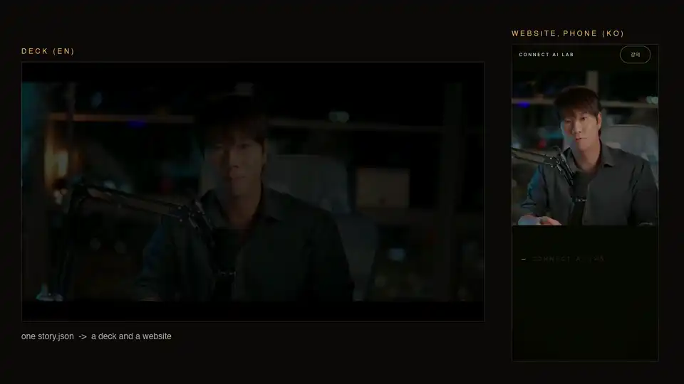
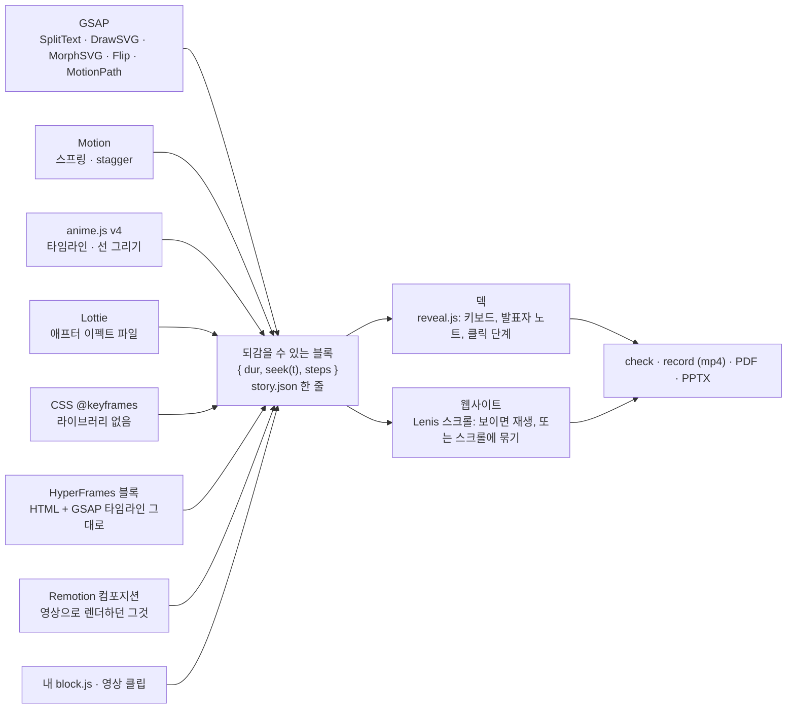

<p align="center">
  <b>CONNECT AI LAB 이 만든 오픈소스</b><br>
  <a href="https://www.youtube.com/@CONNECT-AI-LAB">유튜브 CONNECT AI LAB</a> · <a href="https://www.aicitybuilders.com">강의: aicitybuilders.com</a> · <a href="README.md">English</a>
</p>

# connect-ai-slides-web

**이야기 한 벌로 발표 덱과 웹사이트를 같이 만듭니다.** 코딩 에이전트에게 말로 부탁하면, 브라우저에서 넘기는 발표 덱과 스크롤에 따라 움직이는 웹사이트 한 장이 같은 이야기에서 나옵니다. 모션은 GSAP, Motion, anime.js, Lottie, CSS, HyperFrames, Remotion 것을 그대로 쓰고, 실제 화면을 재서 스스로 검사합니다.



위 데모는 CONNECT AI LAB 을 소개하는 `story.json` 하나를 두 번 만들고, 두 언어로 쓴 것입니다. 한국어([덱 영상](docs/demo/ko/deck.mp4), [폰 영상](docs/demo/ko/phone.mp4), [스토리](docs/demo/ko/story.json)), 영어([덱 영상](docs/demo/en/deck.mp4), [웹 영상](docs/demo/en/site.mp4), [폰 영상](docs/demo/en/phone.mp4), [스토리](docs/demo/en/story.json)). 영상은 만든 사람 본인의 것입니다. 글자는 얼굴과 몸 위에 올라가지 않고, 모든 첫 프레임에서 눈을 뜨고 있으며, 검사가 둘 다 지킵니다.



종합격투기가 모든 무술의 좋은 기술을 모아 함께 쓰게 한 것처럼, 이 키트는 애니메이션 라이브러리를 하나 더 만들지 않습니다. 모든 라이브러리를 **어느 순간으로든 되감을 수 있는 블록**으로 감쌉니다. 그래서 같은 블록이 슬라이드에서는 클릭에, 웹에서는 스크롤에, 녹화에서는 프레임 단위로 움직입니다.

> **라이선스.** 이 키트는 MIT 입니다. reveal.js, Lenis, Motion, anime.js, lottie-web 도 MIT 입니다. 두 가지는 무료로 쓸 수 있지만 오픈소스 라이선스가 **아닙니다**. **GSAP** 는 GreenSock 의 [무상 표준 라이선스](https://gsap.com/standard-license)(무료, 상업 사용과 모든 플러그인 포함; `gsap/*` 와 `hyperframes/*` 블록에서만 불러옴), **Remotion** 은 개인, 직원 3명 이하 회사, 비영리는 무료이고 그 밖의 회사는 [Remotion 회사 라이선스](https://github.com/remotion-dev/remotion/blob/main/LICENSE.md)가 필요합니다(선택 설치; `remotion/*` 블록에서만 쓰고 `npm install --omit=optional` 로 뺄 수 있음). 덱 엔진, 웹 엔진, 검사는 둘 없이 돕니다. 자세한 것은 [NOTICE.md](NOTICE.md).

## 먼저 보기

| | 어디 | 볼 것 |
|---|---|---|
| 카탈로그 페이지 | [docs/index.html](docs/index.html) | 블록 67개 전부의 살아 있는 클립, 복사할 한 줄과 프롬프트. 출처, 쓰임새, 그림이 주인공인 블록으로 거르기 |
| 데모 덱 | [한국어](docs/demo/ko/deck/index.html) · [영어](docs/demo/en/deck/index.html) | 화살표 키, `S` 발표자 노트, `Esc` 전체 보기 |
| 데모 웹사이트 | [한국어](docs/demo/ko/site/index.html) · [영어](docs/demo/en/site/index.html) | 스크롤해 보기, 폰으로도 열어 보기 |
| 블록 전부, 살아 있는 것 | [덱으로](docs/live/deck/index.html) · [한 장으로](docs/live/site/index.html) | 카탈로그 예제 그대로 |
| 내보낸 것 | [한국어 deck.pdf](docs/demo/ko/deck.pdf) · [deck.pdf](docs/demo/en/deck.pdf) · [deck.pptx](docs/demo/en/deck.pptx) · [report.md](docs/demo/en/report.md) | `export` 와 `check` 가 쓰는 파일 |

## 써 보기

Node.js 18 이상과 Chrome(또는 Edge, Chromium)이 필요합니다. 파이썬은 필요 없습니다. ffmpeg 는 `record` 에만 필요합니다.

```bash
git clone https://github.com/wonseokjung/connect-ai-slides-web.git
cd connect-ai-slides-web
npm install
npx connect-ai-slides-web demo        # 견본: 덱 + 웹사이트 + 보고서 (./connect-ai-slides-web-demo)
npx connect-ai-slides-web catalog     # 부를 수 있는 블록 전부
npx connect-ai-slides-web doctor      # 이 컴퓨터가 준비됐는지
```

코딩 에이전트(Claude Code, Codex, Antigravity, Cursor)와 함께: `npx connect-ai-slides-web install-skill` 을 한 번 하고, 말로 부탁합니다. 프롬프트는 영어가 가장 잘 통합니다.

```text
Use connect-ai-slides-web to make a deck and a one-page website about: <my topic>.
Use only the facts I give you: <facts, names, links>.
Show me the scene list first. After my OK, write story.json, build, run check and fix every error.
Then show me the three sheets (deck, web, phone).
```

## 이야기 한 벌, 무대 둘

프로젝트는 `story.json` 과 `media/` 가 든 폴더입니다. 장면 하나가 한 줄입니다. 카탈로그의 `kind` 와 내 글만 적습니다.

```json
{
  "title": "CONNECT AI LAB",
  "look": "connect",
  "brand": {"name": "CONNECT AI LAB", "links": [{"label": "YouTube", "href": "https://www.youtube.com/@CONNECT-AI-LAB"}]},
  "scenes": [
    {"kind": "kit/film-hero", "src": "media/me.mp4", "poster": "media/me.jpg", "face": [0.34, 0.14, 0.23, 0.46],
     "kicker": "CONNECT AI LAB", "title": "AI를 배우는 가장 멋진 방법", "notes": "여기서 할 말."},
    {"kind": "motion/blur-words", "text": "모두를 위한 AI 교육", "gold": "모두를"},
    {"kind": "kit/device-laptop", "src": "media/my-site.mp4", "poster": "media/my-site.jpg", "caption": "노트북에서 본 웹사이트"}
  ]
}
```

`npx connect-ai-slides-web build <project>` 는 정적 폴더 두 개를 씁니다. 서버도 CDN 도 없이 더블클릭으로 열립니다.

- `out/deck/index.html`: 장면 하나 = 슬라이드 하나. 들어오면 재생되고, 단계가 있는 블록은 클릭을 기다립니다. `"notes"` 는 발표자 노트입니다.
- `out/site/index.html`: 장면 하나 = 화면 한 칸. 스크롤해 들어오면 한 번 재생되거나, 고정된 채 스크롤을 따라 움직입니다(`"site": {"mode": "scrub", "len": 2}`). 폰에서는 같은 블록이 세로 배치로 바뀝니다.

## 카탈로그: 블록 67개, 출처 9가지

`npx connect-ai-slides-web catalog` 가 props 와 함께 보여 줍니다. 이름 뒤의 낱말은 쓰임새입니다. **굵은** 이름은 그림이 주인공인 블록입니다(영상, 사진, 기기, 차트, 도식이 화면을 채움). 나머지는 글자가 주인공입니다. 67개 중 34개가 그림이 주인공이고, 글자만 있는 화면이 3장 연속이면 검사가 권합니다.

| 출처 | 블록 |
|---|---|
| **GSAP** (18) | **`bars`** chart · `compare-wipe` compare · `counter` number · `draw-mark` statement · `flip-grid` list · `horizontal-cards` list · `kinetic-type` statement · **`lesson-map`** timeline · **`line-chart`** chart · `marquee-band` background · **`morph-shapes`** steps · `parallax-words` statement · **`path-journey`** timeline · **`pin-showcase`** media · `pin-steps` steps · `scramble-tags` list · `split-title` title · **`video-in-type`** title |
| **Motion** (9) | `blur-words` statement · **`compare-bars`** chart · **`media-card`** media · **`number-ring`** number · **`path-diagram`** diagram · **`photo-stack`** media · `quote` quote · `spring-cards` list · `timeline-years` timeline |
| **anime.js v4** (7) | **`donut-chart`** chart · `draw-icons` list · **`filmstrip`** timeline · **`grid-reveal`** media · `letter-wave` title · `line-steps` steps · **`orbit`** diagram |
| **CSS @keyframes**, 라이브러리 없음 (6) | `big-number` number · **`clip-reveal`** media · **`ken-burns`** media · `light-sweep` chapter · `outline-chapter` chapter · `type-stack` statement |
| **Lottie** (3) | `check-list` list · **`player`** media · `stroke-title` title |
| **HyperFrames 형식 블록** (4) | `player` media · `ring-count` number · `scramble-title` chapter · `split-words` statement |
| **Remotion 컴포지션** (3) | `kinetic-words` statement · `number-roll` number · `player` media |
| **영상 클립** (2) | **`result-reel`** media · **`scrub-video`** media |
| **키트**, 라이브러리 없음 (15) | **`device-laptop`** media · **`device-phone`** media · **`embed-scene`** media · `end-card` cta · **`end-film`** cta · **`film-hero`** person · **`flow-diagram`** diagram · **`hero-video`** person · `ident` ident · **`mosaic`** media · **`nametag`** person · **`photo-frame`** media · **`quote-film`** quote · **`split-film`** compare · **`split-person`** person |

### 이미 만든 것을 그대로 가져오기

| 가진 것 | 한 줄 |
|---|---|
| Remotion 컴포넌트 (2강, 3강) | `{"kind": "remotion/player", "component": "./My.tsx", "durationInFrames": 90, "fps": 30}` |
| HyperFrames 블록 (HTML + GSAP 타임라인) | `{"kind": "hyperframes/player", "src": "media/block.html"}` |
| 애프터 이펙트나 LottieFiles 의 Lottie 파일 | `{"kind": "lottie/player", "src": "media/anim.json"}` |
| [connect-ai-video-motion](https://github.com/wonseokjung/connect-ai-video-motion) 으로 만든 클립 | `{"kind": "motion/media-card", "src": "media/final.mp4", "poster": "media/final.jpg"}` |
| 내 디자인 | 내 폴더의 `block.js`: [docs/BLOCKS.md](docs/BLOCKS.md), 그리고 `"blocks": ["./my-blocks"]` |

## 검사는 실제 화면을 잽니다

`npx connect-ai-slides-web check <project>` 는 덱을 1920x1080 으로, 웹사이트를 1440x900 과 폰 390x844 로 실제 브라우저에서 열고, `out/report.md` 에 문장으로 적습니다. 무엇이, 어디서, 어떻게 고치면 되는지.

| | 오류 (ERROR) | 권장 (ADVICE) |
|---|---|---|
| 글자 크기 | 슬라이드 22 px 미만, 웹과 폰 12 px 미만 | 슬라이드 글 28 px 미만, 폰 문장 16 px 미만 |
| 대비 | 글자 밑 실제 픽셀과의 대비 4.5 미만(큰 글자 3.0), 가장 불리한 10 % 기준 | 투명도 30 % 보다 흐린 글자 |
| 낱말 수 | 슬라이드 한 장 45 초과 | 슬라이드 28 초과, 웹 화면 70 초과 |
| 모션 | | 글이 다 읽히기까지 2.8 초 초과, 클릭 한 단계 4 초 초과, 단계 없이 8 초 초과 |
| 넘침 | 프레임에 잘린 글자, 폰 가로 스크롤, 누르는 곳 44x44 px 미만 | 슬라이드 가장자리 3 % 안의 글자 |
| 사람 | 적어 둔 얼굴 상자나 몸 상자 위에 그려진 모든 것 | 얼굴 상자 없는 사람 블록. 포스터, 영상 첫 프레임, 완성 화면에서 눈을 감았거나 반쯤 감았거나 아래를 보는 사람(macOS, Apple Vision 얼굴 랜드마크. 다른 OS 에서는 건너뜀) |
| 흐름 | | 글자만 있는 화면 3장 연속: 사이에 그림이 주인공인 블록을 넣기 |
| 안정성 | 페이지 오류, 없는 파일, 깨진 그림, 인터넷 요청, 모션 줄이기에서 사라진 글 | 같은 디자인 3번 이상, 발표자 노트 없음, poster 없는 영상, 25 MB 넘는 폴더 |

이 키트를 돌려서 실제로 나온 줄입니다.

```text
ERROR  scene 12 "gsap-compare-wipe" (gsap/compare-wipe, deck): 47 words on one slide. A slide carries one message: keep up to 28, move the rest to "notes" or split the scene in two.
advice scene 6 "purpose" (kit/quote-film, deck): 34 words on one slide. Under 28 is easier to take in while you talk.
check: PASS (0 errors, 11 advice)
eye check: 16 pictures of people measured (poster, first frame, finished screen), 16 with open eyes on the camera
```

검사는 프로젝터 슬라이드와 폰을 흉내 낼 뿐, 내 발표장도 내 폰도 아닙니다. `serve <project>` 가 같은 와이파이의 폰에서 열 주소를 알려 줍니다.

## 얼굴

장면에 사람이 나오면 얼굴 상자를 한 번 적습니다. `"face": [x, y, w, h]`, 각각 그림의 0 에서 1 사이 값입니다. 몸 상자가 있으면 같이 적습니다. `"body": [x, y, w, h]`(쓰는 블록은 props 에 `body` 가 있습니다). 사람 블록은 글을 반대쪽에 놓고 얼굴이 가운데 오게 자르며, 얼굴이나 몸 위에 무엇이든 그려지면 검사가 실패합니다. 맥에서는 포스터, 영상 첫 프레임, 완성 화면의 눈도 보고, 감았거나 아래를 보면 권합니다. 카메라를 보는 순간에서 시작하세요. 키트는 사람의 픽셀을 하나도 바꾸지 않습니다. 그 클립에 `connect-ai-video-motion analyze` 를 돌렸다면 상자는 `work/face.json` 에 있습니다.

## 명령

| | |
|---|---|
| `demo [folder]` | 견본을 처음부터 끝까지 |
| `new <folder>` | 장면 3개짜리 시작 스토리 |
| `catalog [--use x] [--source x] [--json]` | 블록 전부, 쓰임새와 props |
| `build <project> [--deck\|--site]` | `out/deck/index.html`, `out/site/index.html` |
| `check <project> [--deck] [--site] [--phone]` | `out/report.md`, `out/report.json` |
| `serve <project> [--port 4173]` | 내 컴퓨터 주소, 폰에서도 |
| `record <project> [--deck] [--site] [--phone] [--sheet]` | `out/deck.mp4`, `out/site.mp4`, `out/phone.mp4`, `out/sheet_*.jpg`. 프레임마다 정확히 되감아 찍어서 빠지는 프레임이 없음 |
| `export <project> [--pdf] [--pptx]` | `out/deck.pdf`, `out/deck.pptx` |
| `gallery [--clips] [--blocks dir]` | 카탈로그 블록 전부를 예제로; 내 블록 시험도 |
| `install-skill [--claude\|--codex\|--agents]` | 코딩 에이전트에게 카탈로그, 규칙, 순서를 가르침 |
| `doctor` | Node, Chrome, ffmpeg, 선택 설치 꾸러미 |

룩: `"look": "connect"`(검정과 골드, 기본), `"night"`, `"paper"`(밝은 색, 인쇄용). 내용 색은 `"colors"` 로 3개까지, 색 하나에 뜻 하나.

## 하지 않는 것

- **PPTX 와 PDF 는 그림입니다.** 슬라이드마다 끝난 화면 한 장과 발표자 노트가 들어갑니다. 모션은 HTML 덱에 있습니다. `export --pptx-video`(슬라이드마다 mp4)는 실험 기능이고 PowerPoint, Keynote 에서 아직 열어 보지 않았습니다.
- **시각 편집기가 없습니다.** `story.json` 을 직접 또는 에이전트로 고칩니다.
- **macOS 와 Chrome 에서 시험했습니다.** Windows, Linux 의 경로와 브라우저 찾기는 써 두었지만 아직 거기서 돌려 보지 않았습니다. 결과물은 Safari, Firefox 에서도 열리고, 검사는 Chrome 으로만 합니다.
- **시스템 글꼴.** 각 운영체제의 얇은 산세리프를 씁니다(San Francisco, Segoe UI, Apple SD Gothic Neo, 맑은 고딕). 맥과 윈도에서 줄바꿈이 다를 수 있으니 발표할 컴퓨터에서 확인하세요.
- `gsap/scramble-tags` 와 `hyperframes/scramble-title` 은 풀리는 동안 무작위 글자를 보여 줘서, 녹화할 때마다 그 프레임이 다릅니다. 끝난 화면은 항상 같습니다.
- HyperFrames 레지스트리 전체는 들어 있지 않습니다. 거기 블록은 `hyperframes/player` 로 돌립니다. Slidev, Marp 는 감싸지 않았습니다(자체 빌드 단계가 필요).
- `clip/scrub-video` 는 녹화에서 프레임 단위로 확인했습니다. 실제 스크롤은 내 컴퓨터와 폰에서 해 보세요.

## 만든 재료

reveal.js, Lenis, GSAP, Motion, anime.js, lottie-web, Remotion, PptxGenJS, Puppeteer, esbuild 위에 만들었습니다. 이 저장소에 복사해 넣은 남의 코드는 없습니다. 모든 라이브러리는 버전을 고정한 npm 의존성이고 라이선스와 함께 [NOTICE.md](NOTICE.md) 에 있습니다. npm 꾸러미 속 견본은 그린 대역 그림이고, `docs/` 의 데모에는 만든 사람이 본인 허락으로 나옵니다.

비주얼 바이브코딩 강의 4, 5강의 도구입니다. 2강: [connect-ai-video-motion](https://github.com/wonseokjung/connect-ai-video-motion).

MIT · CONNECT AI LAB · [유튜브](https://www.youtube.com/@CONNECT-AI-LAB) · [aicitybuilders.com](https://www.aicitybuilders.com)
