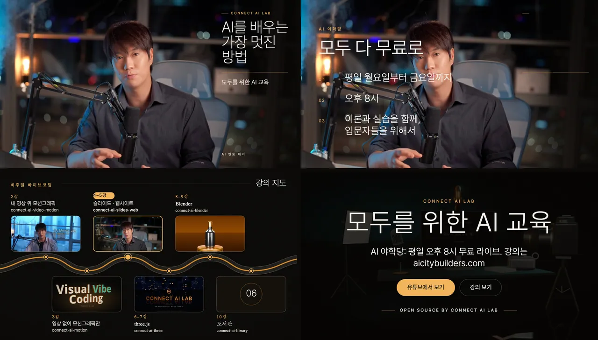
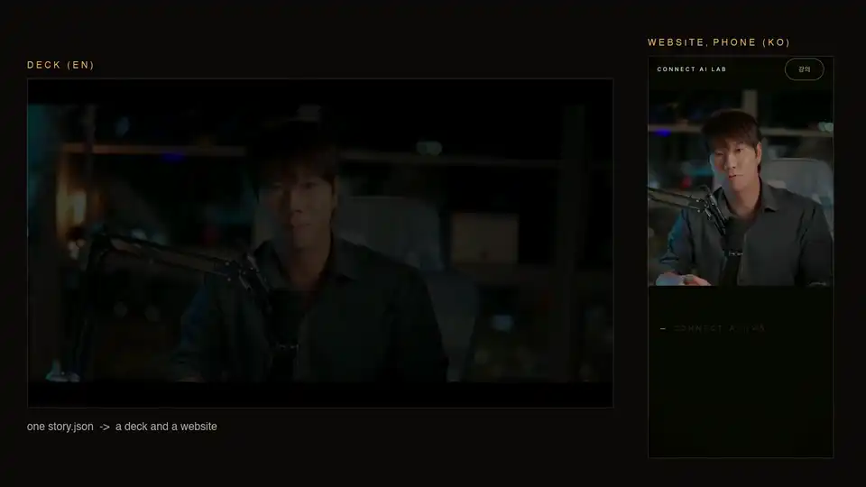

<p align="center"></p>

<p align="center">
  <b>CONNECT AI LAB</b> · AI education for everyone · 모두를 위한 AI 교육<br>
  <a href="https://www.youtube.com/@CONNECT-AI-LAB">YouTube: CONNECT AI LAB</a> · <a href="https://www.aicitybuilders.com/vibecoding">Course: Visual Vibe Coding</a> · <a href="README.ko.md">한국어</a>
</p>

# connect-ai-slides-web

**Motion graphics aren't just for video. The same motion becomes a slide deck or a website.**

My AI presentation employee. Write down a few lines of what you want to say, and you get a deck that moves and a real PowerPoint file.



<sub>That is the .pptx this tool wrote, opened as it is. The gold frames are drawn from the text box positions inside the file.</sub>

## Start

```bash
npx connect-ai-slides-web install-skill
```

Then open a new chat in your agent (Claude Code, Codex, Antigravity, Cursor) and say: "Make a presentation from this."

## Without an agent

```bash
npx connect-ai-slides-web ppt              # writes a sample my-talk.md
npx connect-ai-slides-web ppt my-talk.md   # your words: a deck + deck.pptx
npx connect-ai-slides-web inspect my-talk-deck/out/deck.pptx
```

`#` is the title, `##` is one slide. `-` makes a list, `1.` steps, `>` a quote, and `Note:` goes into the speaker notes.

## Inside the PowerPoint file

| | |
|---|---|
| Words | Real text boxes. Click and edit |
| Motion | One video clip per slide that starts by itself (`--click`: starts on a click) |
| Timing | Each text box fades in when its words appear in the deck |
| Notes | Speaker notes on every slide |
| Google Slides | `--google` also writes a copy with pictures instead of clips |

Open the files yourself: [English deck.pptx](docs/demo/en/deck.pptx) · [Korean deck.pptx](docs/demo/ko/deck.pptx)

## The same story as a website



The deck and the website come from one `story.json`. The website is lesson 5. All 67 motion blocks move on the [catalog page](docs/index.html).

---

Every command, option and limit is in [docs/guide.md](docs/guide.md).

MIT. GSAP is under GreenSock's free [standard license](https://gsap.com/standard-license), and Remotion is free for individuals, companies of up to three people and non-profits; other companies need their own Remotion license. Details in [NOTICE.md](NOTICE.md).

I teach how to build tools like this with your own AI agent in [Visual Vibe Coding](https://www.aicitybuilders.com/vibecoding).

<table><tr>
<td width="140" valign="top"></td>
<td valign="top"><b>Made by AI Mentor Jay</b> · CONNECT AI LAB<br>
I'm building AI employees like this one by one, in the open, and I show how on YouTube and in my course.<br>
<a href="https://www.youtube.com/@CONNECT-AI-LAB">YouTube</a> · <a href="https://www.aicitybuilders.com/vibecoding">Visual Vibe Coding</a> · <a href="https://github.com/wonseokjung">More open source</a></td>
</tr></table>

<!-- team:start -->
## CONNECT AI LAB's AI employees

I'm building AI employees one by one, in the open. Grab the one you need first.

<table>
<tr><td width="34%" valign="top"><b>Business analyst</b><br><a href="https://github.com/wonseokjung/reversebusiness"><code>reversebusiness</code></a></td><td valign="top">Give it a website, and it breaks down how that business makes money.</td></tr>
<tr><td width="34%" valign="top"><b>Video editor</b><br><a href="https://github.com/wonseokjung/connect-ai-video-motion"><code>connect-ai-video-motion</code></a></td><td valign="top">Give it your video, and it puts motion graphics in the empty space around you.</td></tr>
<tr><td width="34%" valign="top"><b>Motion designer</b><br><a href="https://github.com/wonseokjung/connect-ai-motion"><code>connect-ai-motion</code></a></td><td valign="top">Give it a few lines of text, and it makes a motion graphics video. No footage needed.</td></tr>
<tr><td width="34%" valign="top"><b>Presentation maker</b> · <b>this one</b><br><a href="https://github.com/wonseokjung/connect-ai-slides-web"><code>connect-ai-slides-web</code></a></td><td valign="top">Give it a few lines, and it makes a deck that moves and a PowerPoint file you can edit.</td></tr>
<tr><td width="34%" valign="top"><b>Marketing team</b><br><a href="https://github.com/wonseokjung/connect-ai-marketer"><code>connect-ai-marketer</code></a></td><td valign="top">Replies, social listening and uploads, 24/7 in your own browser.</td></tr>
<tr><td width="34%" valign="top"><b>Writer</b><br><a href="https://github.com/wonseokjung/connect-ai-writer"><code>connect-ai-writer</code></a></td><td valign="top">Give it one video, and it writes a post for every platform in your voice, with pictures.</td></tr>
</table>
<!-- team:end -->
