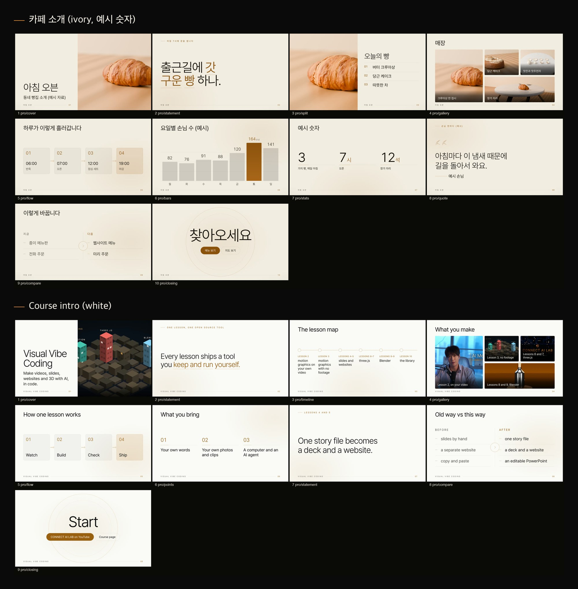
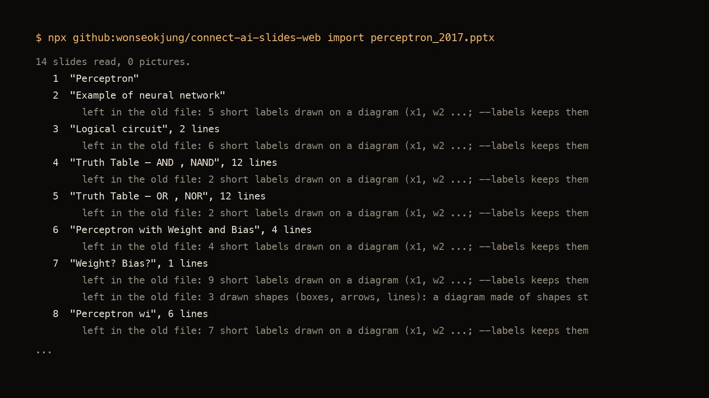
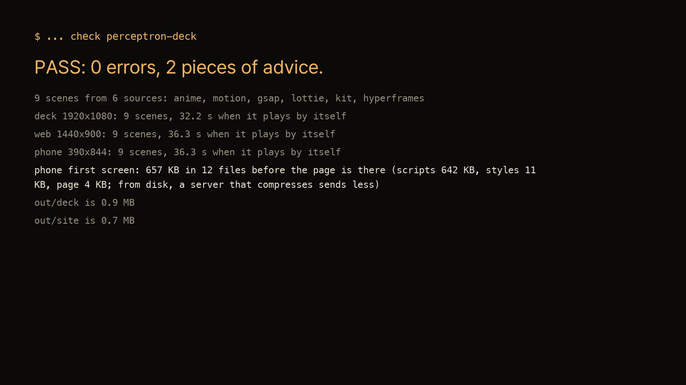
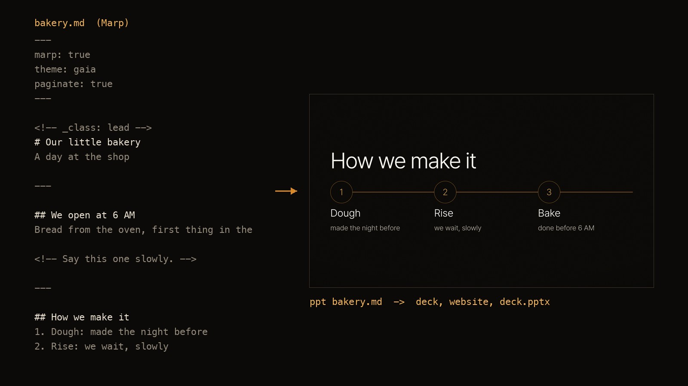

<p align="center"></p>

<p align="center">
  <b>CONNECT AI LAB</b> · AI education for everyone · 모두를 위한 AI 교육<br>
  <a href="https://www.youtube.com/@CONNECT-AI-LAB">YouTube: CONNECT AI LAB</a> · <a href="https://www.aicitybuilders.com/vibecoding">Course: Visual Vibe Coding</a> · <a href="README.ko.md">한국어</a>
</p>

# connect-ai-slides-web

**An AI presentation employee for solo founders and creators. Give it a few lines, and you get a deck that moves and a real PowerPoint file. Your old PPT works too.**

[](docs/showcase/v04/hero.mp4)

```bash
npx github:wonseokjung/connect-ai-slides-web install-skill
```

Paste that line into your agent's chat (Claude Code, Codex, Antigravity, Cursor) and ask it to install it. Then open a new chat and say: "Make a deck about my shop." Got an old PPT? Say: "Remake this PPT so it moves."

You need [Node.js](https://nodejs.org) 18.18 or newer, Chrome and a coding agent. With ffmpeg, the motion goes into PowerPoint as video clips. Use the agent you already have; this tool itself needs no paid API key.

## 0.5: a big design update

Tables become tables or charts, and formulas and a neural network come out as drawings. Every slide puts the title, the footer and the motion in the same place, so a deck reads as one piece. Black and gold by default, with light looks too (white, ivory, paper).


From the top: the 2017 original, 0.4, 0.5. Write a table in the markdown and you get a chart or a table, `$$` gives a formula, `A -> B` gives a flow.



The cafe and the course intro use sample content. The cafe numbers are examples. The photos are renders of CC0 3D models.

Before the agent shows you anything, it checks itself: an empty slide, a crowded one, words on top of words, the same design again and again. It fixes those first.

## What it does

Every picture here is from a real run.

<table>
<tr>
<td width="50%" valign="top"><br><b>Remake an old PPT</b> · v0.4<br><sub>Give it a .pptx and it pulls out the words, pictures and speaker notes, then rebuilds the deck with one message per slide. The gold dashed lines on the right are the text boxes inside the new file.</sub></td>
<td width="50%" valign="top"><br><b>A PPT you can edit word by word</b><br><sub>All the text is in real text boxes. Each slide's motion goes in as a video clip, set to start when the slide opens, and the words appear when they do in the browser deck.</sub></td>
</tr>
<tr>
<td width="50%" valign="top"><br><b>What came in, what stayed behind</b> · v0.4<br><sub>Slide by slide. Diagrams drawn with shapes, charts, equations and hidden slides stay in the old file, and it tells you so.</sub></td>
<td width="50%" valign="top"><br><b>The same talk as a website</b><br><sub>The deck and a one-page website come from the same text. On a phone it moves as you scroll.</sub></td>
</tr>
<tr>
<td width="50%" valign="top"><br><b>It checks its own work</b><br><sub>It opens the deck at real screen sizes and measures type size, words per slide, contrast, and checks for cut-off text. It also checks that the words are all there with motion turned off, and how much a phone has to load first.</sub></td>
<td width="50%" valign="top"><br><b>Marp and Slidev files, as they are</b> · v0.4<br><sub>Already wrote slides in markdown with another tool? Drop the file in. Comments become speaker notes.</sub></td>
</tr>
</table>

## I tried it on my 2017 deck

This is a Perceptron deck I made in 2017 and put on GitHub. I gave it all 14 slides. The titles, sentences and table contents came in. The neural network drawn with shapes, and the small labels on it (x1, w2), stayed in the old file, and the import told me so, slide by slide. In 0.4 the agent cut it down to 9 slides using only my words; in 0.5 the same words became 12 slides, with the truth tables as tables, the formulas with their braces and the network as a drawing. Nothing I didn't say went in.

## Inside the PowerPoint file

| | |
|---|---|
| Words | Real text boxes. Click and edit |
| Motion | One video clip per slide, set to start when the slide opens (`--click`: start on a click). Without ffmpeg you get a still picture instead |
| Notes | Speaker notes on every slide |
| Slide change | A soft fade |
| Google Slides | `--google` adds a copy with still pictures instead of clips |

I checked what's inside the files with `inspect` and looked at them in Quick Look on a Mac. I haven't played them in the PowerPoint app yet, so open yours once on the computer you will present from. Try them: [Korean deck.pptx](docs/demo/ko/deck.pptx) · [English deck.pptx](docs/demo/en/deck.pptx). All 89 motion blocks are on the [catalog page](docs/index.html).

<!-- team:start -->
## CONNECT AI LAB's AI employees

I'm building AI employees one by one, in the open. Grab the one you need first.

<table>
<tr><td width="34%" valign="top"><b>Business analyst</b><br><a href="https://github.com/wonseokjung/reversebusiness"><code>reversebusiness</code></a></td><td valign="top">Give it a website, and it breaks down how that business makes money.</td></tr>
<tr><td width="34%" valign="top"><b>Video editor</b><br><a href="https://github.com/wonseokjung/connect-ai-video-motion"><code>connect-ai-video-motion</code></a></td><td valign="top">Give it your video, and it puts motion graphics in the empty space around you.</td></tr>
<tr><td width="34%" valign="top"><b>Motion designer</b><br><a href="https://github.com/wonseokjung/connect-ai-motion"><code>connect-ai-motion</code></a></td><td valign="top">Give it a few lines of text, and it makes a motion graphics video. No footage needed.</td></tr>
<tr><td width="34%" valign="top"><b>Presentation employee</b> · <b>this one</b><br><a href="https://github.com/wonseokjung/connect-ai-slides-web"><code>connect-ai-slides-web</code></a></td><td valign="top">Give it a few lines or an old PPT, and it makes a deck that moves and a PowerPoint file you can edit.</td></tr>
<tr><td width="34%" valign="top"><b>Marketing team</b><br><a href="https://github.com/wonseokjung/connect-ai-marketer"><code>connect-ai-marketer</code></a></td><td valign="top">Replies, social listening and uploads, 24/7 in your own browser.</td></tr>
<tr><td width="34%" valign="top"><b>Writer</b><br><a href="https://github.com/wonseokjung/connect-ai-writer"><code>connect-ai-writer</code></a></td><td valign="top">Give it one video, and it writes a post for every platform in your voice, with pictures.</td></tr>
<tr><td width="34%" valign="top"><b>XR employee</b><br><a href="https://github.com/wonseokjung/connect-ai-xr"><code>connect-ai-xr</code></a></td><td valign="top">Give it one sentence, and it makes an XR app that opens on Meta Quest, computers and phones.</td></tr>
</table>
<!-- team:end -->

---

Want a quick look before you use an agent? Run `npx github:wonseokjung/connect-ai-slides-web ppt`. It writes a sample script, my-talk.md. Then run `npx github:wonseokjung/connect-ai-slides-web ppt my-talk.md` and you get the PowerPoint file. Every command and option, and what it does not do, is in [docs/guide.md](docs/guide.md).

MIT license. GSAP is under GreenSock's [free standard license](https://gsap.com/standard-license), and Remotion is free for individuals, companies of up to 3 people and non-profits; larger companies need a Remotion company license. Everything this kit uses is listed in [NOTICE.md](NOTICE.md).

I teach how to build tools like this with your own AI agent in [Visual Vibe Coding](https://www.aicitybuilders.com/vibecoding).

<table><tr>
<td width="140" valign="top"></td>
<td valign="top"><b>Made by AI Mentor Jay</b> · CONNECT AI LAB<br>
I'll keep releasing AI employees as open source, one by one, and show how I build them on YouTube and in my course.<br>
<a href="https://www.youtube.com/@CONNECT-AI-LAB">YouTube</a> · <a href="https://www.aicitybuilders.com/vibecoding">Visual Vibe Coding</a> · <a href="https://github.com/wonseokjung">More open source</a></td>
</tr></table>
