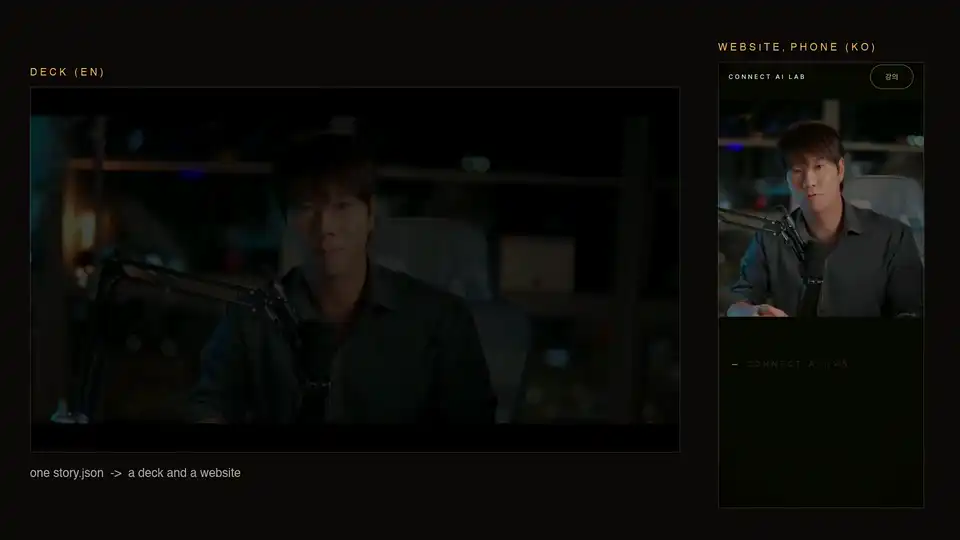
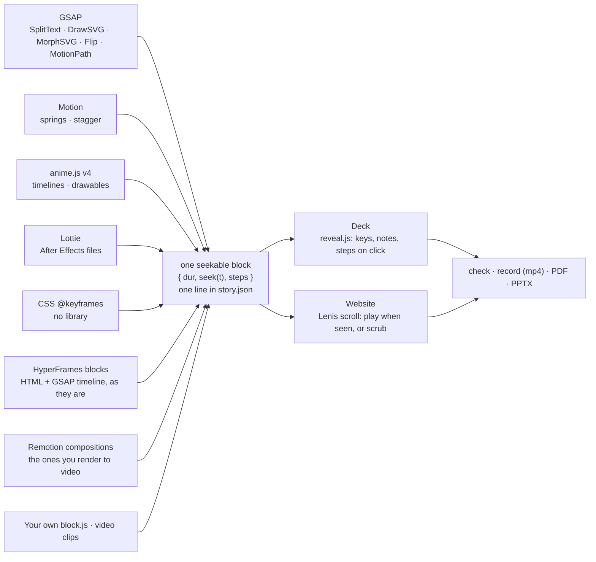

<p align="center">
  <b>Open source by CONNECT AI LAB</b><br>
  <a href="https://www.youtube.com/@CONNECT-AI-LAB">YouTube CONNECT AI LAB</a> · <a href="https://www.aicitybuilders.com">Courses: aicitybuilders.com</a> · <a href="README.ko.md">한국어</a>
</p>

# connect-ai-slides-web

**One story. A deck and a website.** Tell your coding agent the story. You get a deck you present in the browser and a one-page website that moves as you scroll, from the same story, with motion from GSAP, Motion, anime.js, Lottie, CSS, HyperFrames and Remotion, checked on the real screen.



The demo above is one `story.json` about CONNECT AI LAB, built twice and told in two languages: English ([deck video](demo/en/deck.mp4), [website video](demo/en/site.mp4), [phone video](demo/en/phone.mp4), [the story](demo/en/story.json)) and Korean ([deck video](demo/ko/deck.mp4), [phone video](demo/ko/phone.mp4), [the story](demo/ko/story.json)). The footage is the author's own. The text never sits on his face or body, his eyes are open on every first frame, and the check enforces both.



Like mixed martial arts took the best moves of every style and made them work together, this kit does not invent one more animation library. Every library becomes a block that can be seeked to any moment, so the same block plays on a slide when you click, on a web page when you scroll, and frame by frame when you record.

> **Licences.** This kit is MIT. reveal.js, Lenis, Motion, anime.js and lottie-web are MIT. Two sources are free to use but are **not** open-source licences: **GSAP** uses GreenSock's [standard no-charge licence](https://gsap.com/standard-license) (free, commercial use and all plugins included; loaded only by `gsap/*` and `hyperframes/*` blocks), and **Remotion** is free for individuals, companies with up to 3 employees and non-profits, other companies need a [Remotion Company License](https://github.com/remotion-dev/remotion/blob/main/LICENSE.md) (optional; used only by `remotion/*` blocks, leave it out with `npm install --omit=optional`). The deck engine, the website engine and the check run without both. Details: [NOTICE.md](../NOTICE.md).

## See it

| | Where | What to look at |
|---|---|---|
| Catalog page | [docs/index.html](index.html) | all 89 blocks as live clips, with a line and a prompt to copy; filter by source, use, or picture first |
| Demo deck | [English](demo/en/deck/index.html) · [Korean](demo/ko/deck/index.html) | arrow keys, `S` for speaker notes, `Esc` for the overview |
| Demo website | [English](demo/en/site/index.html) · [Korean](demo/ko/site/index.html) | scroll it; open it on a phone too |
| Every block, live | [as a deck](live/deck/index.html) · [as one page](live/site/index.html) | the catalog examples themselves |
| Exports | [deck.pdf](demo/en/deck.pdf) · [deck.pptx](demo/en/deck.pptx) · [Korean deck.pdf](demo/ko/deck.pdf) · [Korean deck.pptx](demo/ko/deck.pptx) · [report.md](demo/en/report.md) | what `export` and `check` write |

## Try it

You need Node.js 18 or newer and Chrome (or Edge / Chromium). No Python. ffmpeg only for `record`.

```bash
git clone https://github.com/wonseokjung/connect-ai-slides-web.git
cd connect-ai-slides-web
npm install
npx connect-ai-slides-web demo        # the sample: deck + website + report, in ./connect-ai-slides-web-demo
npx connect-ai-slides-web catalog     # every block you can call
npx connect-ai-slides-web doctor      # is this computer ready?
```

With a coding agent (Claude Code, Codex, Antigravity, Cursor): `npx connect-ai-slides-web install-skill`, then ask in your own words:

```text
Use connect-ai-slides-web to make a deck and a one-page website about: <my topic>.
Use only the facts I give you: <facts, names, links>.
Show me the scene list first. After my OK, write story.json, build, run check and fix every error.
Then show me the three sheets (deck, web, phone).
```

## One story, two stages

A project is a folder with `story.json` and `media/`. One scene is one line: a `kind` from the catalog and its words.

```json
{
  "title": "CONNECT AI LAB",
  "look": "connect",
  "brand": {"name": "CONNECT AI LAB", "links": [{"label": "YouTube", "href": "https://www.youtube.com/@CONNECT-AI-LAB"}]},
  "scenes": [
    {"kind": "kit/film-hero", "src": "media/me.mp4", "poster": "media/me.jpg", "face": [0.34, 0.14, 0.23, 0.46],
     "kicker": "CONNECT AI LAB", "title": "The most beautiful way to learn AI", "notes": "What I say here."},
    {"kind": "motion/blur-words", "text": "AI education for everyone.", "gold": "everyone"},
    {"kind": "kit/device-laptop", "src": "media/my-site.mp4", "poster": "media/my-site.jpg", "caption": "The website, on a laptop"}
  ]
}
```

`npx connect-ai-slides-web build <project>` writes two static folders. No server, no CDN, they open by double click:

- `out/deck/index.html`: one scene = one slide. It plays when you arrive, blocks with steps wait for your click, `"notes"` are the speaker notes.
- `out/site/index.html`: one scene = one screen. It plays once when you scroll to it, or it stays pinned and follows the scroll (`"site": {"mode": "scrub", "len": 2}`). On a phone the same block switches to its tall layout.

## What you write, what you get (`ppt talk.md`)

| In the markdown | On the slide (pro design) |
|---|---|
| `# Title` and a line under it, `` under that | the cover, with the picture on the right |
| `## Heading` with nothing under it | a chapter slide (01, 02 ...) |
| one sentence, `**gold words**` inside | a large statement, those words in gold |
| `- a` `- b` `- c` | points (up to 4), more: a numbered list |
| `1. a` `2. b` | a flow; `Lesson 2: ...`, `2강: ...`, `Q1: ...` labels: a timeline |
| `**42%** what it means` (one or more lines) | a big number, or a row of numbers |
| a table with numbers in the second column | columns; a line when the labels are in time order |
| a table with words | a clean table; two tables side by side |
| `$$ y = w1 x1 + b $$`, or a `$$` block with `0 if ...` lines | a formula; cases with a brace |
| `plot: step, sigmoid, relu` | function curves on axes |
| `A -> B -> C`, `Input [x1 x2] -> Output [y]` | a flow, a network diagram |
| `Before: a, b` and `After: x, y` | before and after, side by side |
| one picture and a list / 2 to 4 pictures | photo and words side by side / a gallery |
| `> words` then `- who` | a quote |
| `[Label](https://...)` on the last slide | buttons |
| `Note: ...` | speaker notes (without it, the slide's own words are the notes) |

## The catalog: 89 blocks, 10 sources

`npx connect-ai-slides-web catalog` prints them with their props. The word after each name is what it is for. A **bold** name is led by a picture (a video, a photo, a device, a chart or a diagram fills the screen); the others are led by type. 47 of the 89 are led by a picture, and the check advises when three text-only screens come in a row.

| Source | Blocks |
|---|---|
| **Pro design set**, GSAP (22): one header, footer and motion language for a whole deck; the default for `ppt` since 0.5 | `agenda` list · **`bars`** chart · `chapter` chapter · `closing` cta · **`compare`** compare · `cover` title · **`equation`** diagram · **`flow`** steps · **`gallery`** media · **`line`** chart · **`network`** diagram · **`photo`** media · **`plot`** diagram · `points` list · `quote` quote · **`ring`** chart · **`split`** media · `stat` number · `statement` statement · `stats` number · **`table`** compare · **`timeline`** timeline |
| **GSAP** (18) | **`bars`** chart · `compare-wipe` compare · `counter` number · `draw-mark` statement · `flip-grid` list · `horizontal-cards` list · `kinetic-type` statement · **`lesson-map`** timeline · **`line-chart`** chart · `marquee-band` background · **`morph-shapes`** steps · `parallax-words` statement · **`path-journey`** timeline · **`pin-showcase`** media · `pin-steps` steps · `scramble-tags` list · `split-title` title · **`video-in-type`** title |
| **Motion** (9) | `blur-words` statement · **`compare-bars`** chart · **`media-card`** media · **`number-ring`** number · **`path-diagram`** diagram · **`photo-stack`** media · `quote` quote · `spring-cards` list · `timeline-years` timeline |
| **anime.js v4** (7) | **`donut-chart`** chart · `draw-icons` list · **`filmstrip`** timeline · **`grid-reveal`** media · `letter-wave` title · `line-steps` steps · **`orbit`** diagram |
| **CSS @keyframes**, no library (6) | `big-number` number · **`clip-reveal`** media · **`ken-burns`** media · `light-sweep` chapter · `outline-chapter` chapter · `type-stack` statement |
| **Lottie** (3) | `check-list` list · **`player`** media · `stroke-title` title |
| **HyperFrames-format blocks** (4) | `player` media · `ring-count` number · `scramble-title` chapter · `split-words` statement |
| **Remotion compositions** (3) | `kinetic-words` statement · `number-roll` number · `player` media |
| **Video clip** (2) | **`result-reel`** media · **`scrub-video`** media |
| **Kit**, no library (15) | **`device-laptop`** media · **`device-phone`** media · **`embed-scene`** media · `end-card` cta · **`end-film`** cta · **`film-hero`** person · **`flow-diagram`** diagram · **`hero-video`** person · `ident` ident · **`mosaic`** media · **`nametag`** person · **`photo-frame`** media · **`quote-film`** quote · **`split-film`** compare · **`split-person`** person |

### Bring what you already made

| You have | One line |
|---|---|
| a Remotion component (lessons 2 and 3) | `{"kind": "remotion/player", "component": "./My.tsx", "durationInFrames": 90, "fps": 30}` |
| a HyperFrames block (HTML + GSAP timeline) | `{"kind": "hyperframes/player", "src": "media/block.html"}` |
| a Lottie file from After Effects or LottieFiles | `{"kind": "lottie/player", "src": "media/anim.json"}` |
| a clip made with [connect-ai-video-motion](https://github.com/wonseokjung/connect-ai-video-motion) | `{"kind": "motion/media-card", "src": "media/final.mp4", "poster": "media/final.jpg"}` |
| your own design | a `block.js` in your own folder: [docs/BLOCKS.md](BLOCKS.md), then `"blocks": ["./my-blocks"]` |

## The check measures the real screen

`npx connect-ai-slides-web check <project>` opens the deck at 1920x1080, the website at 1440x900 and on a 390x844 phone in a real browser, and writes `out/report.md` in sentences: what, where, how to fix it.

| | ERROR | ADVICE |
|---|---|---|
| Type size | under 22 px on a slide, under 12 px on web and phone | slide text under 28 px, phone sentences under 16 px |
| Contrast | under 4.5 (3.0 for large type) against the pixels really behind the text, judged by the unlucky 10 % | text more transparent than 30 % |
| Words | more than 45 on one slide | more than 28 on a slide, 70 on a web screen |
| Motion | | text readable only after 2.8 s, a click step longer than 4 s, 8 s without steps |
| Fit | text cut off by the frame, sideways scroll on a phone, a tap target under 44x44 px | text in the outer 3 % of a slide |
| People | anything drawn on a declared face box, or on a declared body box | a person block without a face box; eyes closed, half closed or looking down on a poster, a first frame or the finished screen (macOS, Apple Vision face landmarks; skipped elsewhere) |
| Rhythm | | three text-only screens in a row: put a picture-led block between them |
| Stability | a page error, a missing file, a broken picture, any request to the internet, text missing with reduced motion | a design used more than twice, no speaker notes, a video without a poster, a folder over 25 MB |

Real lines from this kit's own runs:

```text
ERROR  scene 12 "gsap-compare-wipe" (gsap/compare-wipe, deck): 47 words on one slide. A slide carries one message: keep up to 28, move the rest to "notes" or split the scene in two.
advice scene 6 "purpose" (kit/quote-film, deck): 34 words on one slide. Under 28 is easier to take in while you talk.
check: PASS (0 errors, 11 advice)
eye check: 16 pictures of people measured (poster, first frame, finished screen), 16 with open eyes on the camera
```

The check emulates a projector slide and a phone. It is not your room and not your phone: `serve <project>` prints an address for a phone on the same Wi-Fi.

## Faces

If a scene shows a person, write the face box once: `"face": [x, y, w, h]`, each 0 to 1 of the picture, and the body box too if you have it: `"body": [x, y, w, h]` (blocks that use it list `body` in their props). Person blocks put the words on the other side and centre the crop on the face, and the check fails if anything is drawn on the face or the body. On a Mac the check also looks at the eyes in the poster, the first frame of the video and the finished screen, and advises when they are closed or looking down: pick a start where the person looks at the camera. The kit never changes a pixel of the person. If you ran `connect-ai-video-motion analyze` on the clip, the box is in its `work/face.json`.

## Commands

| | |
|---|---|
| `demo [folder]` | the sample, start to finish |
| `new <folder>` | a three-scene starter story |
| `catalog [--use x] [--source x] [--json]` | every block, its use and its props |
| `build <project> [--deck\|--site]` | `out/deck/index.html`, `out/site/index.html` |
| `check <project> [--deck] [--site] [--phone]` | `out/report.md`, `out/report.json` |
| `serve <project> [--port 4173]` | a local address, also for your phone |
| `record <project> [--deck] [--site] [--phone] [--sheet]` | `out/deck.mp4`, `out/site.mp4`, `out/phone.mp4`, `out/sheet_*.jpg`. Each frame is seeked exactly, nothing is dropped |
| `ppt [talk.md] [--ko] [--look connect\|night\|white\|ivory\|paper] [--google] [--click] [--no-video] [--still-words] [--pdf] [--classic]` | from a markdown or text file to `<name>-deck/out/deck.pptx` in one go, in the pro design (`--classic`: the 0.4 mapping); with no file it writes a sample `my-talk.md` |
| `ppt old.pptx` · `import old.pptx [--out talk.md] [--no-pictures] [--hidden] [--labels]` | An old PowerPoint file: its words, pictures and speaker notes into `old.md` + `old-media/`; `ppt` goes on to the new deck and .pptx. Diagrams drawn with shapes, charts, equations, EMF pictures and hidden slides are reported per slide and stay in the old file |
| Marp · Slidev · reveal.js markdown | A file with `---` between slides goes straight into `ppt`. Comments become speaker notes; settings (theme, layout, class) stay off the slides |
| `export <project> [--pdf] [--pptx] [--google] [--click] [--no-video] [--still-words] [--pptx-pictures]` | `out/deck.pdf`, `out/deck.pptx` (editable text boxes, the motion as clips, fades, notes), `out/deck_google.pptx` |
| `inspect <file.pptx> [--json]` | what is inside a .pptx: text boxes, clips, which start by themselves, notes |
| `gallery [--clips] [--blocks dir]` | every catalog block from its example; also tries your own blocks |
| `install-skill [--claude\|--codex\|--agents]` | teaches your coding agent the catalog, the rules and the order |
| `doctor` | Node, Chrome, ffmpeg, optional packages |

Looks: `"look": "connect"` (black and gold, the default), `"night"`, `"paper"` (light, for print). Up to three content colours with `"colors"`, one meaning each.

## What it does not do

- **The PPTX is a picture with words on top.** Words become real text boxes you can edit. Everything else (shapes, photos, the motion) is one picture or one video clip behind them per slide, so you cannot move a single shape in PowerPoint, and a much longer sentence typed into a box can run past the card painted behind it (change the markdown and make the file again). Each text box keeps one alignment and one line height; an indented or uneven layout can sit a little differently, and a computer without the font shows a similar one. Clip playback and fades were checked in the file and in Apple Quick Look; open it in PowerPoint or Keynote before you present (`tools/keynote-check.mjs` does that on a Mac). Google Slides does not play videos inside a .pptx: use `deck_google.pptx`.
- **The PDF holds pictures.** One finished screen per page, with the words as a searchable layer.
- **No visual editor.** You edit `story.json`, by hand or through your agent.
- **Tested on macOS with Chrome.** Windows and Linux paths and browser lookup are written but not yet run there. Safari and Firefox open the output; the check runs in Chrome only.
- **System fonts.** The look uses the thin system sans of each platform (San Francisco, Segoe UI, Apple SD Gothic Neo, Malgun Gothic). Line breaks can differ between a Mac and a Windows PC: check on the computer you present from.
- `gsap/scramble-tags` and `hyperframes/scramble-title` show random letters while decoding, so two recordings differ in those frames. The finished screen is always the same.
- The full HyperFrames registry is not included; any block from it runs through `hyperframes/player`. Slidev and Marp are not wrapped (they need their own build step).
- `clip/scrub-video` was verified frame by frame in recordings; try the live scroll on your own machine and phone.

## Credits

Built on reveal.js, Lenis, GSAP, Motion, anime.js, lottie-web, Remotion, PptxGenJS, Puppeteer and esbuild. No third-party source code is copied into this repository: every library is an npm dependency with a pinned version, listed with its licence in [NOTICE.md](../NOTICE.md). The sample in the npm package uses a drawn stand-in; the demo in `docs/` shows the author, with his permission.

Part of the Visual Vibe Coding course, lessons 4 and 5. Lesson 2: [connect-ai-video-motion](https://github.com/wonseokjung/connect-ai-video-motion).

MIT · CONNECT AI LAB · [YouTube](https://www.youtube.com/@CONNECT-AI-LAB) · [aicitybuilders.com](https://www.aicitybuilders.com)
